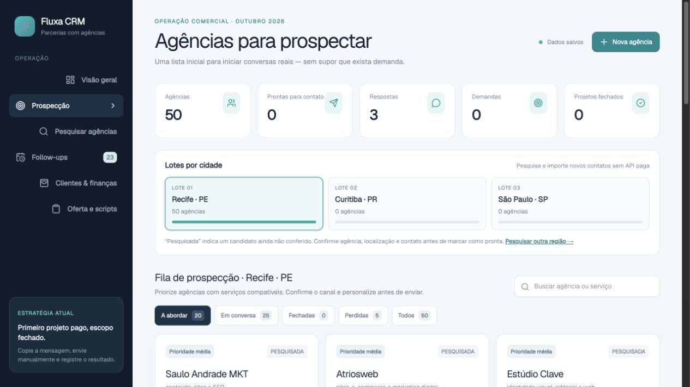
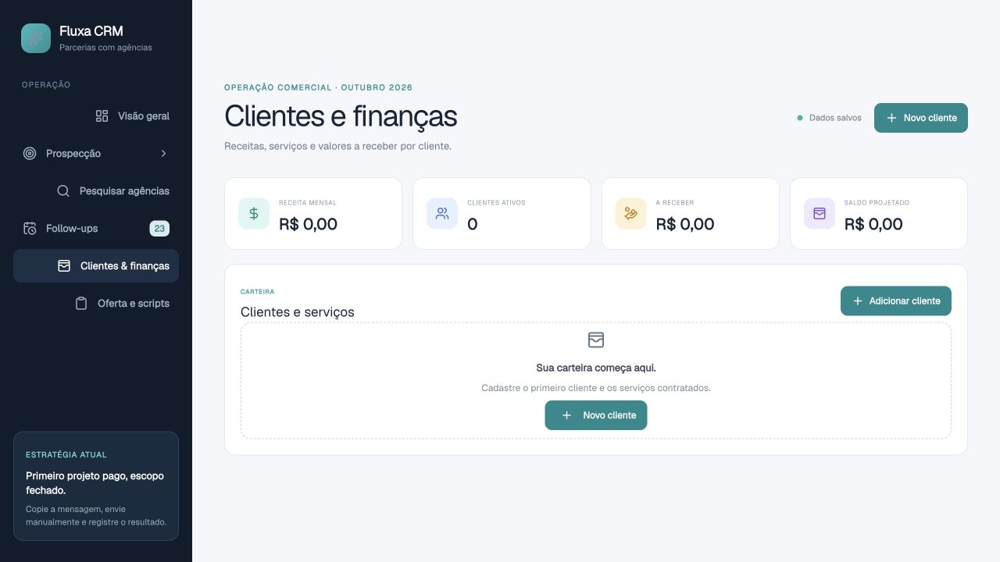

# Fluxa AI — CRM de prospecção e vendas

O **Fluxa AI** é uma aplicação comercial criada para pesquisar negócios locais, qualificar oportunidades, organizar abordagens, acompanhar follow-ups, gerar prévias editáveis de sites e controlar clientes e receitas.

> Este repositório apresenta o produto como case de portfólio. O código-fonte é privado porque o projeto está em desenvolvimento comercial.

[Acessar a aplicação](https://fluxa-crm-alpha.vercel.app/login)

## Problema resolvido

Pequenos prestadores de serviço perdem oportunidades porque os contatos ficam espalhados entre Google Maps, Instagram, WhatsApp e anotações. O Fluxa reúne esse processo em um funil visual, da descoberta do lead ao fechamento.

## Principais recursos

- pesquisa de empresas por cidade, estado e nicho;
- qualificação por nota, avaliações, presença digital e disponibilidade de site;
- fila de prospecção com prioridade e estágio;
- atalhos para WhatsApp e Instagram;
- roteiros de abordagem revisados pelo usuário;
- follow-ups, notas e histórico por oportunidade;
- criação de prévias editáveis de sites para demonstração comercial;
- cadastro de clientes, serviços, mensalidades, despesas e valores a receber;
- dashboard executivo responsivo.

## Prospecção organizada

Cada oportunidade concentra contexto comercial, canal de contato, estágio, próxima ação e histórico. As mensagens permanecem sob controle humano: o sistema prepara o contato, mas o usuário revisa e confirma o envio.

## Clientes e finanças

O módulo financeiro conecta a prospecção à carteira conquistada, permitindo acompanhar serviços ativos, receita recorrente, despesas e saldo pendente.

## Fluxo do produto

Pesquisa → qualificação → abordagem → aceite → prévia → proposta → venda → acompanhamento.

## Tecnologias utilizadas

- React e TypeScript
- Next.js / Vinext e Vite
- Supabase e PostgreSQL
- Cloudflare Workers e D1
- Tailwind CSS
- integração com fontes públicas e ferramentas de pesquisa local

## Decisões de produto

- interface responsiva para desktop e celular;
- confirmação humana antes de abordagens externas;
- dados demonstrativos nas capturas;
- separação entre a apresentação pública e o código comercial privado;
- evolução planejada para autenticação multiusuário e recursos assistidos por IA.

## Autoria

Produto concebido e desenvolvido por **Gabriel Oliveira**.

© 2026 Gabriel Oliveira. Todos os direitos reservados. As imagens e a identidade do Fluxa AI não podem ser reutilizadas comercialmente sem autorização.
